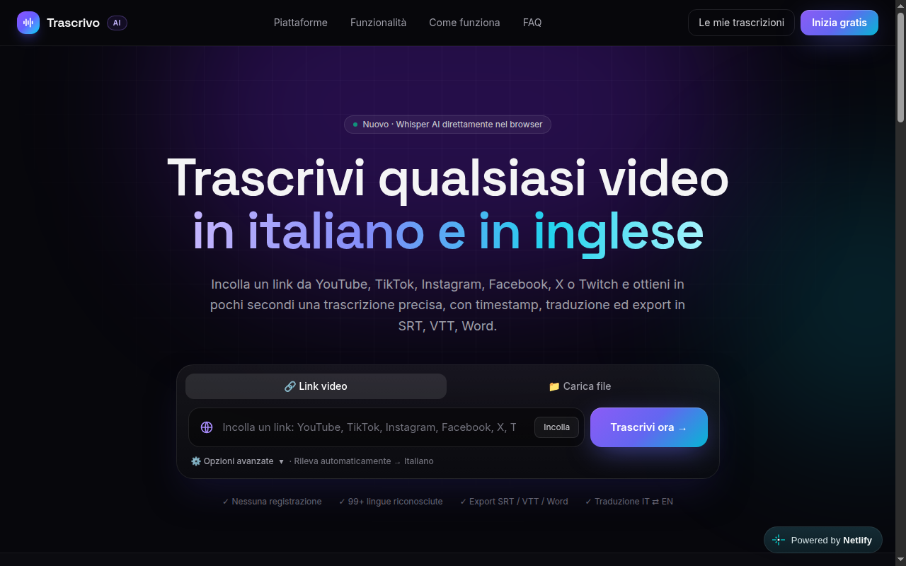

# Trascrivo — Multilingual Video Transcription Platform

 

**Trascrivo** è una piattaforma web per la trascrizione automatica di video in italiano e in inglese. Incolla il link di un video da YouTube, TikTok, Instagram, Facebook, X/Twitter, Twitch, Vimeo, Reddit, Dailymotion, LinkedIn o oltre 1000 siti supportati, oppure carica un file audio/video dal tuo computer, e ottieni in pochi secondi una trascrizione precisa con timestamp, traduzione ed export in formati professionali.

Nessuna registrazione richiesta. La trascrizione nel browser mantiene l’audio interamente sul tuo dispositivo.

## Caratteristiche principali

- Trascrizione in secondi: sottotitoli nativi quando disponibili, altrimenti AI Whisper.
- Italiano e inglese: traduci l’intera trascrizione mantenendo i timestamp sincronizzati.
- Oltre 1000 siti supportati: YouTube, TikTok, Instagram, Facebook, X, Twitch, Vimeo, Reddit e molti altri.
- Timestamp cliccabili: clicca su una frase per saltare al punto esatto del video.
- Export professionale: TXT, SRT, VTT, Word (.doc), JSON o PDF.
- Privacy by design: nel browser l’audio non lascia mai il tuo dispositivo.
- Ricerca nel testo con evidenziazione e contatore dei risultati.
- Cronologia e condivisione con link pubblico.

## Screenshot



## Ultime funzionalità aggiunte

- **Gestione errori migliorata**: l'API di trascrizione ora gestisce errori in modo più robusto, restituendo messaggi di errore JSON chiari
- **Script di database**: aggiunti comandi `db:init`, `db:start`, `db:stop` e `db:push` per gestire il database PostgreSQL embedded
- **Miglioramenti all'API**: l'API di trascrizione ora supporta parametri di qualità e gestisce meglio i tipi di dati
- **Struttura progetto migliorata**: organizzazione più chiara dei file API e componenti

## Come funziona

1. Incolla il link del video o carica un file audio/video.
2. Vengono recuperati i sottotitoli originali o, se mancanti, l’audio viene trascritto con Whisper AI.
3. Puoi tradurre in italiano o inglese, cercare nel testo, modificare ed esportare in SRT, VTT, TXT o Word.

## Stack tecnologico

- Next.js 16 con App Router e React 19
- TypeScript 5
- PostgreSQL con Drizzle ORM
- Tailwind CSS 4
- Whisper AI via Groq/OpenAI
- Whisper ONNX nel browser tramite Hugging Face Transformers
- yt-dlp per estrazione audio e sottotitoli

## Struttura del progetto

```
multilingual-video-transcription-platform/
├── src/
│   ├── app/
│   │   ├── api/
│   │   │   ├── transcribe/
│   │   │   ├── transcripts/
│   │   │   ├── upload/
│   │   │   ├── media/
│   │   │   └── config/
│   │   ├── history/
│   │   ├── t/[id]/
│   │   ├── page.tsx
│   │   └── layout.tsx
│   ├── components/
│   │   ├── workspace/
│   │   ├── TranscribeForm.tsx
│   │   ├── HistoryList.tsx
│   │   └── Header.tsx
│   ├── db/
│   │   ├── schema.ts
│   │   └── index.ts
│   └── lib/
│       ├── client/
│       ├── server/
│       └── format.ts
├── drizzle.config.json
├── next.config.ts
├── package.json
└── tsconfig.json
```

## Avvio in sviluppo

Prerequisiti: Node.js 18+. Il database PostgreSQL gira in user-space (embedded, nessuna installazione o password di sistema richiesta). Servono anche `ffmpeg` e, per l'estrazione dai video, `yt-dlp` (vedi "Strumenti esterni").

```bash
# Installa le dipendenze
npm install

# Configura le variabili d'ambiente
cp .env.example .env.local

# Inizializza, avvia il PostgreSQL embedded e applica lo schema
npm run db:init && npm run db:push

# Avvia in sviluppo
npm run dev
```

Comandi database utili:

| Comando | Effetto |
| --- | --- |
| `npm run db:init` | Crea (se serve) e avvia il cluster PostgreSQL in `.pgdata` |
| `npm run db:start` / `npm run db:stop` | Avvia o ferma il database |
| `npm run db:push` | Applica lo schema Drizzle |

## Strumenti esterni

- `yt-dlp`: versioni pre-2026 falliscono su YouTube (per l'ultima verifica la mia versione potrebbe non bastare). Consigliato il binario standalone aggiornato:
  ```bash
  curl -sL -o ~/.local/bin/yt-dlp https://github.com/yt-dlp/yt-dlp/releases/latest/download/yt-dlp_linux && chmod +x ~/.local/bin/yt-dlp
  ```
  Poi punta `YTDLP_PATH` a quel binario; in sua assenza l'app scarica automaticamente l'ultima release in una cartella temporanea.
- `ffmpeg`: `sudo apt install ffmpeg` (usato da yt-dlp per l'estrazione audio).

## Variabili d'ambiente

| Variabile | Descrizione |
| --- | --- |
| `DATABASE_URL` | Connessione PostgreSQL (default: istanza embedded) |
| `YTDLP_PATH` | Percorso di un binario yt-dlp alternativo (consigliato se quello di sistema è vecchio) |
| `OPENAI_API_KEY` | Chiave API OpenAI per Whisper |
| `GROQ_API_KEY` | Chiave API Groq come alternativa a OpenAI (piano gratuito disponibile) |
| `MYMEMORY_EMAIL` | Email per aumentare il limite MyMemory per la traduzione |

## Licenza

MIT

---

**© 2026 Alex Mirici — Web Developer**

---

## Changelog

### v1.0.0 — Prima release pubblica
- Trascrizione AI con Whisper (Groq/OpenAI) e sottotitoli nativi
- Supporto di oltre 1000 piattaforme video
- Traduzione italiano/inglese con timestamp sincronizzati
- Export in TXT, SRT, VTT, Word, JSON, PDF
- Ricerca nel testo, cronologia e condivisione pubblica
- Privacy by design: trascrizione nel browser
- Database PostgreSQL embedded per sviluppo locale
